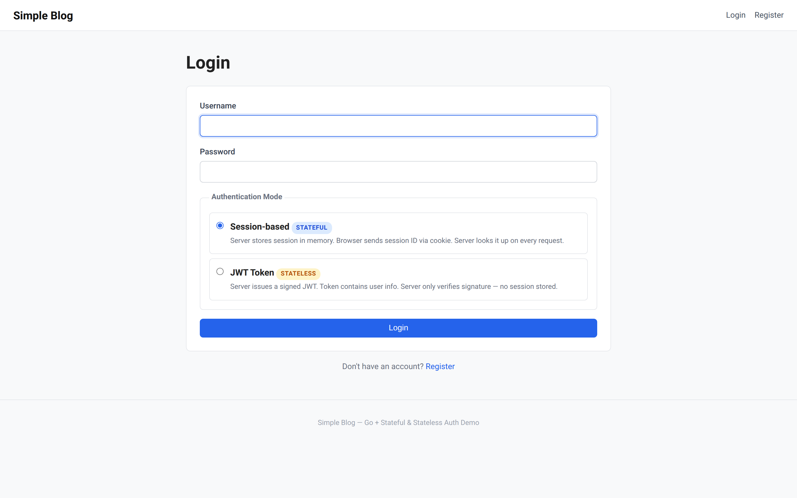
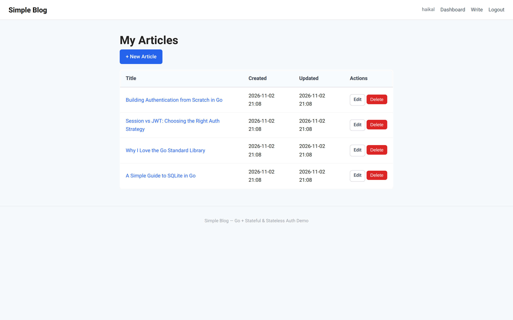
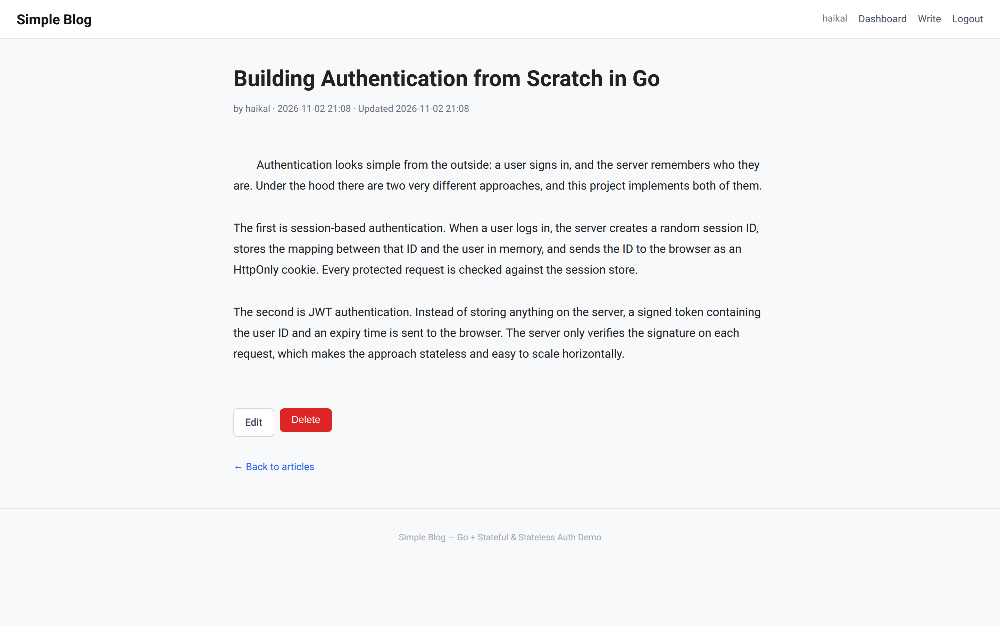
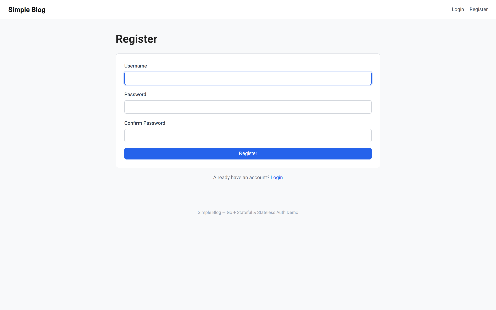
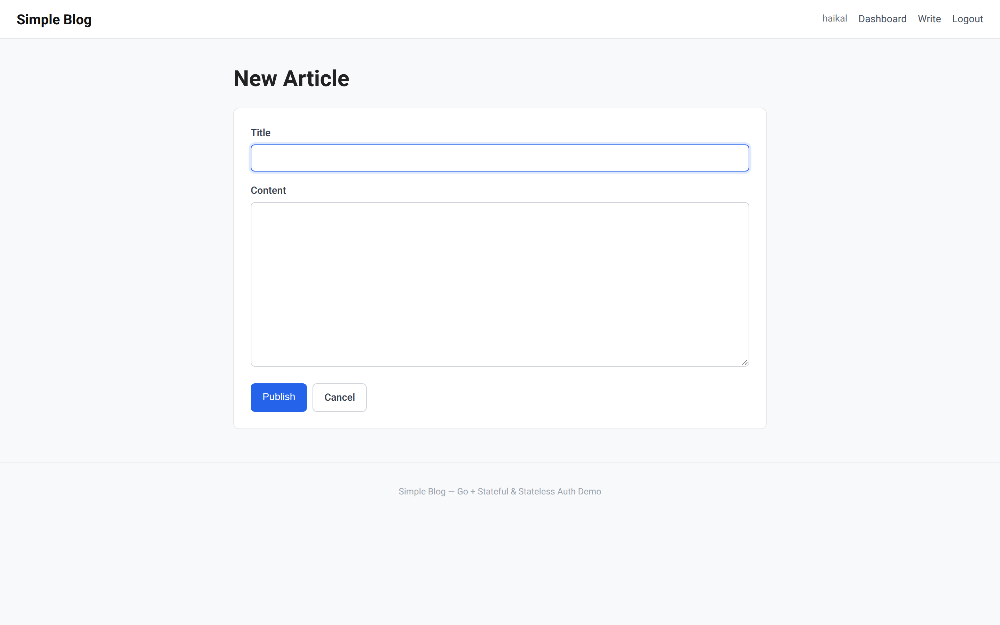

# Simple Blog — Go Authentication Demo

A small blog application built with Go's standard library that demonstrates **two authentication strategies side by side**: stateful **session-based** auth and stateless **JWT** auth. Users can register, choose an auth mode when logging in, publish articles, and manage only their own posts.


## Table of Contents

- [Preview](#preview)
- [Features](#features)
- [Tech Stack](#tech-stack)
- [How Authentication Works](#how-authentication-works)
- [Project Structure](#project-structure)
- [Getting Started](#getting-started)
- [Routes](#routes)
- [Notes & Limitations](#notes--limitations)
- [License](#license)

## Preview

| Home | Login (choose auth mode) |
| --- | --- |
|  |  |

| Dashboard | Article |
| --- | --- |
|  |  |

| Register | Write Article |
| --- | --- |
|  |  |

## Features

- **Two auth modes in one app** — pick Session or JWT on the login page.
- **Secure password storage** — passwords are hashed with bcrypt.
- **Stateful sessions** — random 32-byte session IDs kept in an in-memory store with `sync.RWMutex`.
- **Stateless JWTs** — HS256 tokens signed with a secret, carrying the user ID and a 15-minute expiry.
- **HttpOnly cookies** — auth tokens are never readable from JavaScript.
- **Route middleware** — `RequireAuth`, `RequireGuest`, and `OptionalAuth`.
- **Ownership checks** — users can only edit or delete their own articles.
- **Server-rendered UI** — `html/template` with a shared base layout.
- **Zero framework** — just the Go standard library plus a few small dependencies.
- **SQLite storage** — schema is created automatically on first run.

## Tech Stack

| Layer | Choice |
| --- | --- |
| Language | Go 1.25+ |
| HTTP | `net/http` (method + path pattern routing) |
| Templates | `html/template` |
| Database | SQLite via `modernc.org/sqlite` (pure Go, no CGO) |
| Password hashing | `golang.org/x/crypto/bcrypt` |
| JWT | `github.com/golang-jwt/jwt/v5` |
| Env loading | `github.com/joho/godotenv` |
| Styling | Plain CSS |

## How Authentication Works

The login form posts a `mode` field. The server then issues one of two cookies:

**Session-based (stateful)**

1. On login, the server generates a random session ID with `crypto/rand`.
2. The ID is stored in an in-memory `map[string]int64` mapping session → user ID.
3. The browser receives a `session_id` HttpOnly cookie.
4. On each request, middleware looks the ID up in the store. Logging out deletes it, so revocation is immediate.

**JWT (stateless)**

1. On login, the server signs an HS256 token containing `userId` and a 15-minute `exp`.
2. The browser receives a `token` HttpOnly cookie.
3. On each request, middleware verifies the signature and expiry. Nothing is stored server-side.

Both modes share the same middleware, so protected pages behave identically regardless of how the user logged in.

## Project Structure

```text
simple-blog-auth/
├── auth/
│   ├── jwt.go          # Generate & verify JWT tokens
│   ├── middleware.go   # RequireAuth, RequireGuest, OptionalAuth
│   └── session.go      # In-memory session store
├── database/
│   ├── db.go           # SQLite connection, schema, queries
│   └── app.db          # Created automatically at runtime (gitignored)
├── handlers/
│   ├── article.go      # Article CRUD handlers
│   ├── auth.go         # Register, login, logout
│   └── page.go         # Page handlers + template rendering
├── models/
│   ├── article.go
│   └── user.go
├── static/
│   └── style.css
├── templates/          # base.html + page templates
├── .env.example
├── go.mod
├── go.sum
└── main.go             # Routes and server bootstrap
```

## Getting Started

### Prerequisites

- Go 1.25 or newer
- Git

### Installation

```bash
# 1. Clone the repository
git clone https://github.com/hekalrapli/simple-blog-auth.git
cd simple-blog-auth

# 2. Create your environment file
cp .env.example .env

# 3. Generate a strong JWT secret and put it in .env
openssl rand -hex 32

# 4. Download dependencies
go mod download

# 5. Run the app
go run .
```

Open [http://localhost:8080](http://localhost:8080) in your browser.

On first launch the app creates `database/app.db` and initializes the schema automatically. Register an account, then try logging in with **Session-based** and **JWT Token** modes to compare the cookies in your browser's developer tools.

### Configuration

| Variable | Required | Description |
| --- | --- | --- |
| `JWT_SECRET` | Yes | Secret used to sign and verify JWT tokens. The app exits if it is missing. |

## Routes

| Method | Path | Access | Description |
| --- | --- | --- | --- |
| `GET` | `/` | Public | List all articles |
| `GET` | `/articles/{id}` | Public | View an article |
| `GET` | `/login/` | Guests only | Login page |
| `GET` | `/register/` | Guests only | Register page |
| `POST` | `/register` | Public | Create an account |
| `POST` | `/login` | Public | Log in (session or JWT mode) |
| `GET` | `/dashboard/` | Auth required | List the current user's articles |
| `GET` | `/articles/new` | Auth required | New article form |
| `POST` | `/articles` | Auth required | Create an article |
| `GET` | `/articles/{id}/edit` | Owner only | Edit article form |
| `POST` | `/articles/{id}/edit` | Owner only | Update an article |
| `POST` | `/articles/{id}/delete` | Owner only | Delete an article |
| `GET` | `/logout` | Auth required | Clear the auth cookie(s) |

## Notes & Limitations

This project is intended as a learning/demo application. Before using it in production, consider:

- Sessions live in process memory, so they are lost on restart and not shared across instances. Use Redis or a database-backed store for horizontal scaling.
- There is no CSRF protection on state-changing forms.
- Cookies are not marked `Secure` because the demo runs over HTTP locally.
- The JWT secret should be long, random, and kept out of version control (`.env` is gitignored).

## License

Released under the [MIT License](LICENSE).
